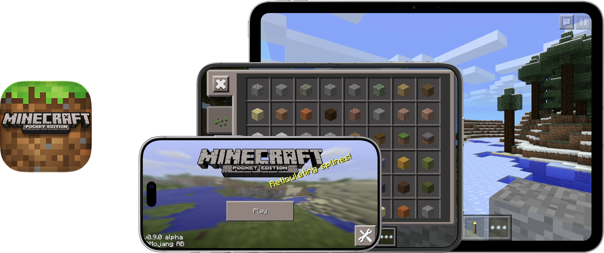

  

# Respring – Minecraft PE

Minecraft: Pocket Edition 0.9.0, restored with the help of Codex for modern iPhones and iPads as part of project Respring.

### How does it work?

The original 2014 game runs on a modified touchHLE runtime. It interprets ARM/Thumb instructions and runs selected terrain, lighting, and rendering routines as native code after checking them against the original game. A native iOS host handles the display, touch input, and audio. The game runs without JIT.

### Enhancements

- **Full-resolution rendering.** The world and HUD can render at the display’s native resolution. Expanded View lets the 3D scene use the window’s proportions.
- **iPhone and iPad layouts.** Choose the original 3.5-inch or 4-inch iPhone canvas, or the iPad interface. Automatic selects the iPad layout on iPad and iPhone Duo.
- **Smoother gameplay.** Background terrain processing lets the game keep drawing while it prepares chunks or rebuilds terrain after a block edit. Choose a target of 30, 60, or up to 120 FPS and turn on the live FPS counter.
- **App switching.** Switch away and return to the same world while iOS keeps the app in memory.

### Notes

- Display and terrain options are in **Settings → Apps → Minecraft PE**. Relaunch after changing the display settings or folding the Duo to a different size.
- In the original **New World** screen, choose **Infinite** for a world that generates more terrain as you explore. New chunks can take time to appear, especially when flying.
- If you run into a problem, include your device, world type, and terrain setting when [opening an issue](https://github.com/DylanMcD8/respring-minecraft-pe/issues).

## How to Install

Download **Minecraft-PE.ipa** from [Releases](https://github.com/DylanMcD8/respring-minecraft-pe/releases). It is an unsigned ARM64 device app. Sign it for your iPhone or iPad with your preferred sideloading tool, such as [Sideloadly](https://sideloadly.io).

Alternatively, open **MinecraftPE.xcodeproj** and build with your own Apple development team. The deployment target is iOS/iPadOS 15.0. Restoration testing included the physical iPad mini (A17 Pro), iPhone Duo, and iPhone Air, and the iOS 27.1 Duo simulator.

## Build from Source

*Written by AI agent*

1. Install the pinned Rust toolchain, ARM64 targets, and CMake on an Apple silicon Mac with full Xcode. See [BUILDING.md](BUILDING.md).
2. Open `MinecraftPE.xcodeproj`, select the **MinecraftPE** scheme, and choose your destination.
3. For a physical device, select your development team and an available bundle identifier. Build and run.

The repository includes the original game payload, the modified runtime, and the dependencies for the offline Cargo build.

## Credits and Licensing

Minecraft: Pocket Edition was created by Mojang. Minecraft and its original game assets belong to their respective rights holders. Respring is an unofficial preservation project.

The compatibility runtime derives from [touchHLE](https://github.com/touchHLE/touchHLE). The runtime, SDL2, and other dependencies retain their respective licenses. See [LICENSE.md](LICENSE.md) and [THIRD_PARTY_NOTICES.md](THIRD_PARTY_NOTICES.md).
